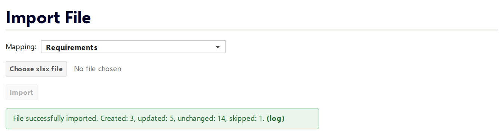

# Quick start

The shortest way from an installed extension to the first imported file.

## Deploy Excel Importer to Polarion

Take the file `ch.sbb.polarion.extension.excel-importer-<version>.jar` from the page of
[releases](https://github.com/SchweizerischeBundesbahnen/ch.sbb.polarion.extension.excel-importer/releases) and copy
it to the folder `<polarion_home>/polarion/extensions/ch.sbb.polarion.extension.excel-importer/eclipse/plugins`.

## Restart Polarion

Stop Polarion.
Delete the `<polarion_home>/data/workspace/.config` folder.
Start Polarion.

The administration of every project now has the node `Excel Importer`. Its `About` page shows the version of the
extension and the status of its configuration.

## Create a mapping

A mapping tells the extension which column of the Excel file goes into which field of a work item.

1. Open the administration of the project and select `Excel Importer` ➙ `Mappings`.
2. Press `Add new` and give the mapping a name.
3. Fill in the [general settings](USER_GUIDE.md#general-settings), at least the sheet and the first row to import.
4. Select the [work item type](USER_GUIDE.md#workitem-type) in `Import rows as`.
5. Map the [columns to fields](USER_GUIDE.md#column-to-field-mapping) with the `+` button.
6. Select the [link column](USER_GUIDE.md#link-column): the column which identifies the work item of a row.
7. Press `Save`.

## Import a file

1. Select `Excel Importer` ➙ `Import File`.
2. Select the mapping, choose the xlsx file and press `Import`.
3. Read the result line: it counts the created, updated, unchanged and skipped work items, and its `(log)` link
   downloads what happened to each row.



An import is all or nothing: after an error message no work item was changed.

## Let users import

The pages above are part of the administration. To let users who are not administrators import files, put
`Import File` into the navigation of the project:

1. In the administration of the project select `Portal` ➙ `Topics` and edit the desired view.
2. Add the topic and save:
   ```xml
   <topic id="excel-importer"/>
   ```

## Ready to go

From here:

- The [user guide](USER_GUIDE.md) explains every setting of a mapping and the content each field type accepts.
- The [REST API](REST_API.md) runs the same import from a script.
- The [Velocity functions](VELOCITY_FUNCTIONS.md) export tables of a Polarion page to Excel.
