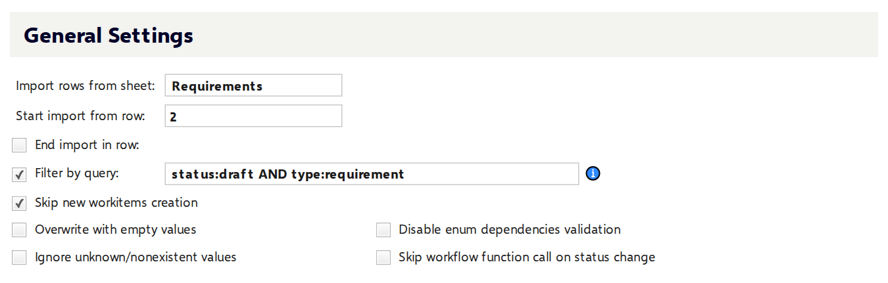
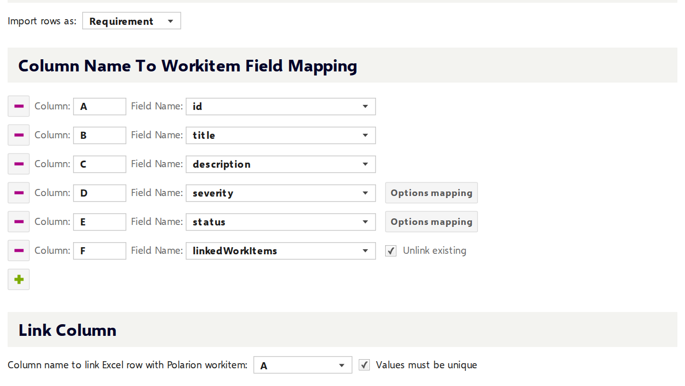
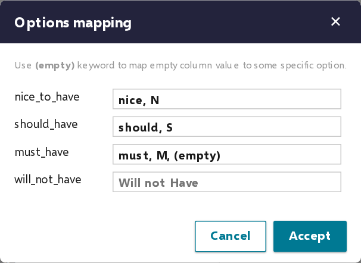
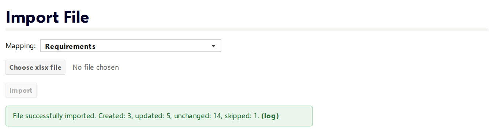
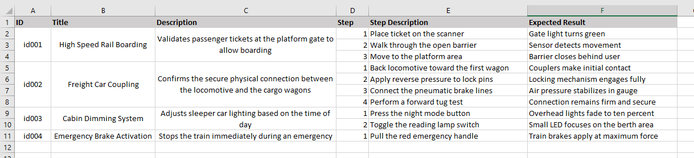
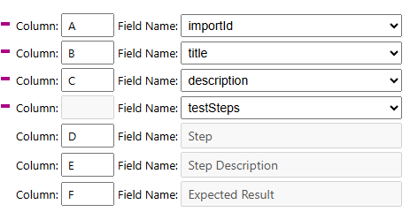
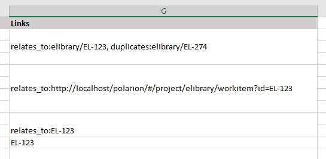

# User Guide

How to describe an Excel file with a mapping and import it into work items. For the first steps see the
[quick start page](QUICK_START.md); the import can also be driven by a script through the [REST API](REST_API.md),
and tables of a Polarion page can be exported to Excel with the [Velocity functions](VELOCITY_FUNCTIONS.md).

## Table of contents

* [How the import works](#how-the-import-works)
* [Mappings](#mappings)
    * [General settings](#general-settings)
    * [Workitem type](#workitem-type)
    * [Column to field mapping](#column-to-field-mapping)
    * [Link column](#link-column)
* [Importing a file](#importing-a-file)
* [Cell values](#cell-values)
* [Test Steps table import](#test-steps-table-import)
* [Linked work items](#linked-work-items)
* [Hyperlinks](#hyperlinks)

## How the import works
The extension reads the rows of one sheet of an xlsx file and writes each of them into a work item of the current project.
What is read and where it is written is described by a **mapping**: a named configuration which is created once and
then chosen for every file of the same layout.

For each row the extension takes the value of the [link column](#link-column) and looks in the project for work items
whose mapped field holds the same value:

| Work items found | What happens                                                                                                                                                                      |
|------------------|-----------------------------------------------------------------------------------------------------------------------------------------------------------------------------------|
| One              | The work item is updated with the values of the row.                                                                                                                              |
| Several          | All of them are updated, and the log has an `ATTENTION!` line about it.                                                                                                           |
| None             | A new work item of the mapping's [type](#workitem-type) is created from the row. With `id` as the [link column](#link-column) the row is skipped instead, unless its ID is empty. |

Two settings of the mapping narrow this down: `Filter by query` limits the work items which can be updated, and
`Skip new workitems creation` turns the last line of the table into a skipped row. See
[Updating only some work items](#updating-only-some-work-items).

Good to know:

- **An import is all or nothing.** All rows are written in one transaction. When the import fails on any row, is
  cancelled or runs out of time (60 minutes), nothing is imported.
- **Only changed values are written.** A field which already holds the value of the cell is left alone, so importing
  the same file again creates no new revisions. Such work items are counted as *unchanged*.
- **A row can be skipped without failing the import** - see [Importing a file](#importing-a-file) for the cases. The
  reason is in the log.
- Rows where all mapped columns are empty are ignored.

Both pages are in the administration of a **project**, under `Excel Importer`: `Mappings` and `Import File`.
`Import File` can also be put into the project's navigation for users who are not administrators: add
`<topic id="excel-importer"/>` to the topics of the desired view (project administration, `Portal` > `Topics`).

## Mappings
A project can have any number of mappings. The pane at the top of the page selects, creates, renames and deletes them,
and `Save` stores the selected one. `Revisions` shows the history of the selected mapping and can bring an earlier
state back into the form (it still has to be saved). Mappings exist per project, there are no global ones.

### General settings



This mapping reads the sheet `Requirements` from its second row and only updates: draft requirements get the values
of their rows, every other row is skipped.

| Setting                                      | Description                                                                                                                                                                                                                                             |
|----------------------------------------------|---------------------------------------------------------------------------------------------------------------------------------------------------------------------------------------------------------------------------------------------------------|
| Import rows from sheet                       | Name of the sheet to read, `Sheet1` by default. The import fails if the file has no sheet with this name.                                                                                                                                               |
| Start import from row                        | Number of the first row to import, as Excel shows it. Set it to `2` to skip a header row.                                                                                                                                                               |
| End import in row                            | Optional. Number of the last row to import; the rows below it are ignored. Must not be less than the start row.                                                                                                                                         |
| Filter by query                              | Optional. A Lucene query, e.g. `status:draft AND type:requirement`. Only the work items which match it can be updated, the others are skipped. See [below](#updating-only-some-work-items).                                                             |
| Skip new workitems creation                  | Checked: the import only updates. A row for which no work item is found is skipped instead of creating one. See [below](#updating-only-some-work-items).                                                                                                |
| Overwrite with empty values                  | Checked: an empty cell clears the field of the work item. Unchecked: an empty cell leaves the field as it is. Checked in a new mapping. An empty cell of a required field or of a boolean field then fails the import, see [Cell values](#cell-values). |
| Ignore unknown/nonexistent values            | Checked: a [linked work item](#linked-work-items) which cannot be found is left out and mentioned in the log. Unchecked: it fails the import.                                                                                                           |
| Disable enum dependencies validation         | Unchecked: a row is skipped when the value of a dependent enum field does not fit the value of the field it depends on. Checked: such values are imported as they are. See [below](#enum-dependencies).                                                 |
| Skip workflow function call on status change | Unchecked: a status change of an existing work item is performed as a workflow action, and the row is skipped when the action is not available or fails. Checked: the status is written directly. See [below](#status-changes-and-the-workflow).        |

#### Updating only some work items
By default every row is written: into the work items the link column finds, or into a new one. Two settings restrict
this, each on its own or both together.

**Filter by query** takes a query in Polarion's Lucene syntax, the one the work item search uses. The project does
not have to be part of it, the import never leaves the current project. A work item which the link column finds but
which does not match the query is skipped, and the log says that it does not match the filter query.

- The query does not limit what is created. A row for which the link column finds no work item at all still creates
  one, and the new work item does not have to match the query. Check `Skip new workitems creation` to prevent this.
- A work item which is outside the query is never created a second time: it exists, so its row is skipped.
- The query is checked before anything is written. An import with a query which Polarion cannot run fails with
  `Filter query '...' is invalid, nothing was imported`.

**Skip new workitems creation** makes the import update-only: a row for which no work item is found is skipped, and
the log says that no work item was created because of this setting. The [work item type](#workitem-type) of the
mapping is then used only for the list of fields.

| Filter by query | Skip new workitems creation | Work item found, matches the query | Found, does not match | Not found |
|-----------------|-----------------------------|------------------------------------|-----------------------|-----------|
| -               | -                           | Updated                            | Updated               | Created   |
| Set             | -                           | Updated                            | Skipped               | Created   |
| -               | Checked                     | Updated                            | Updated               | Skipped   |
| Set             | Checked                     | Updated                            | Skipped               | Skipped   |

The log starts with a line for each of the two settings which is in effect.

#### Enum dependencies
Polarion lets a custom enum field depend on another field, so that its form offers only the options which fit the
value of the controlling field. Polarion applies this in its forms only, so an import could store any combination.
The extension therefore checks each row after all its values are set, and skips the row when a combination is not
allowed. The log names the value, the field and the value of the controlling field.

- Only the dependencies which involve a mapped field are checked, as the dependent or as the controlling field.
- While the controlling field is empty, every option is allowed, as in Polarion's form.
- The check looks at the resulting work item. A combination which was already invalid before the import is reported
  too, when one of its two fields is mapped and the row changes the work item. A work item which the row leaves
  unchanged is not checked.

#### Status changes and the workflow
A status written directly into a work item bypasses the workflow: no conditions are checked and no functions run.
So when a row changes the status of an existing work item, the extension performs the first available workflow
action which leads from the current status to the new one. Other values of the row are set first, the action sees them.
The action can change the work item further, for example clear the fields which the workflow configures to be cleared.

When there is no such action, its conditions are not fulfilled or a function fails, the row is skipped and the log
gives the reason. New work items are not affected: Polarion performs their initial action itself.

### Workitem type
The type of the work items which the import creates. It also defines which fields the mapping offers: the fields of
this type, plus the custom fields defined for all types. This holds with `Skip new workitems creation` checked too,
when nothing is created.

The type does not restrict updates: an existing work item of any type is updated when the link column finds it. The
import fails if such a work item has no field with a mapped ID.

### Column to field mapping
Each line maps one Excel column to one work item field. A column is given by its letters (`A`, `B`, ... `AA`), which
can be typed or picked from the list. A column can be used once, and so can a field.



The mapping above reads requirements: column `A` holds the work item ID and is the link column, `B` to `E` fill
the title, the description, the severity and the status, and `F` lists the linked work items.

Some fields get extra controls:

- **Enum and boolean fields** have an `Options mapping` button. It opens a dialog with one input per option, which
  takes a comma-separated list of cell values to be read as this option, e.g. `yes, y, 1` for `true`. The keyword
  `(empty)` stands for an empty cell.

  

  Here `must`, `M` and an empty cell are imported as `must_have`. A cell with `should_have` or `Should Have` needs
  no entry: the ID and the name of an option are always recognized.
- **Test steps fields** take no column of their own but one column per step column, see
  [Test Steps table import](#test-steps-table-import).
- **`linkedWorkItems`** has an `Unlink existing` checkbox, see [Linked work items](#linked-work-items).

The work item `id` can only be mapped if its column is the link column, and it is never written.

A field which is required in Polarion cannot be cleared: with `Overwrite with empty values` checked an empty cell in
its column fails the import with `Cannot set empty value to the required field`. Uncheck the option to leave such
fields as they are.

### Link column
The column which identifies the work item of a row. It must be one of the mapped columns. Its field is used for the
lookup only: it is filled in a new work item and never changed in an existing one.

- **Mapped to a custom or standard field** (e.g. an ID from another system): every row must have a value in this
  column, a row without one fails the import. A value which is not found creates a new work item.
- **Mapped to `id`**: a row with an ID which does not exist in the project is skipped, because a work item cannot be
  created with a given ID. A row with an empty ID creates a new work item.

A value finds a work item only if the field holds exactly the same text. `0001` does not find `00011`, upper and
lower case are different values, and so are values which differ in their spaces. A numeric cell can be used: it is
compared as the number Excel stores, see [Cell values](#cell-values). A cell formatted as date or of Excel's own
boolean type cannot, it fails the import.

`Values must be unique` cancels the import when a value occurs more than once in the link column. This is checked
before anything is written; the error lists the repeated values with their rows. Empty values are not checked.

Without it a repeated value is imported row by row. An existing work item is then written once per row, the last
row wins, and it appears in the result as often. A value which is not in the project yet can create one work item
per row, because the work items are looked up before the rows are written.

## Importing a file
1. Open `Import File`.
2. Select the mapping.
3. Choose the xlsx file and press `Import`.

The import runs in the background, the page waits for it. Leaving the page does not stop the import, but its result
is then not shown anywhere. The result line counts the work items by outcome:



| Outcome   | Meaning                                                                                                                                                                                                                                                                                                               |
|-----------|-----------------------------------------------------------------------------------------------------------------------------------------------------------------------------------------------------------------------------------------------------------------------------------------------------------------------|
| Created   | A new work item was created.                                                                                                                                                                                                                                                                                          |
| Updated   | An existing work item got new values.                                                                                                                                                                                                                                                                                 |
| Unchanged | An existing work item already held all values of the row.                                                                                                                                                                                                                                                             |
| Skipped   | Nothing was written for the row: its `id` was not found, its work item is outside the [filter query](#updating-only-some-work-items) or was not found while creation is switched off, an [enum dependency](#enum-dependencies) is broken, or the [workflow action](#status-changes-and-the-workflow) did not succeed. |

The `(log)` link downloads a text file with one line per row, which says what happened to it and why.

An error instead of the result line means that nothing was imported. Typical causes are a sheet which does not
exist, an invalid filter query, a value which does not fit its field, an empty value in the link column and a linked work item which does
not exist.

The same import is available through the [REST API](REST_API.md).

## Cell values

| Field type      | Accepted cell content                                                                                                                                                                                                                                                                                                             |
|-----------------|-----------------------------------------------------------------------------------------------------------------------------------------------------------------------------------------------------------------------------------------------------------------------------------------------------------------------------------|
| Text, rich text | Any text. In a rich text field line breaks of the cell are kept.                                                                                                                                                                                                                                                                  |
| Number          | A numeric cell, or a number as text. In an integer field the decimals are cut off: `1.7` becomes `1`.                                                                                                                                                                                                                             |
| Boolean         | The text `true` or `false` in any case, or a value from the options mapping. Anything else fails the import, including a cell of Excel's own boolean type - format the column as text. An empty cell fails too when `Overwrite with empty values` is checked, unless the options mapping has `(empty)` for one of the two values. |
| Enum            | A value from the options mapping, the ID of an option or its name (case is ignored). For a multi-value field several values are separated by commas. The ID of an option and a value of the options mapping must be written exactly, case included.                                                                               |
| Date, time      | A cell formatted as date in Excel, or text in ISO format: `yyyy-MM-dd`, `yyyy-MM-ddTHH:mm:ss`, `HH:mm:ss` or `HH:mm`. Text of any other form clears the field, whatever `Overwrite with empty values` says, and fails the import for a required field.                                                                            |
| Duration        | Days and hours only, as Polarion writes them: `1d`, `1/2h`, `2 1/2h`, `3d 1h`.                                                                                                                                                                                                                                                    |
| Assignee        | The IDs or names of users who can be assigned in the project, separated by commas without spaces. The cell is the complete list of assignees. Other fields which hold a user cannot be imported.                                                                                                                                  |

A numeric cell is read as the number Excel stores, not as the cell shows it. A whole number comes without decimals,
so `2207371` arrives in a text field as `2207371`. A number format is not applied: a cell which shows `001`, `1,500`
or `50%` is read as `1`, `1500` and `0.5`. Format the column as text in Excel to import what the cell shows.

The `description` of a work item is a rich text field, so the line breaks of its cell are kept as well.

Merged cells have a meaning: they mark the rows of a [test steps table](#test-steps-table-import). A merged region
in a data row, even in a column which is not mapped, makes the importer read that row as such a table, and the
import then usually fails with `Cannot set multi-value into field`. Unmerge the cells of a sheet without test steps.

A formula cell is read as the value Excel calculated for it. A cell with an error value (e.g. `#N/A`) in a mapped
column fails the import; the error names the cell.

## Test steps table import
It is possible to import test steps table. To do this, the file should have a specific structure: all non-table cells must be merged e.g.:



The mapping configuration for the example above should look like this:



Rules for such a file:

- The merged cells define which rows belong to one work item; the columns of the steps hold one step per row.
- All columns of the test steps table must be mapped.
- Merged regions must not overlap partially: two regions cover either the same rows or different ones.
- When `End import in row` cuts through a merged region, the steps below that row are not imported.
- The steps of the work item are replaced by the ones of the file as a whole, whatever `Overwrite with empty values`
  says. A row without merged cells gives one step.
- The text of a step is stored as HTML as it is. A line break inside the cell is therefore not shown, and `<` or `&`
  are read as markup; write `<br/>`, `&lt;` and `&amp;` instead.

## Linked work items
In order to link imported work items using 'linkedWorkItems' field the cell must contain a comma-separated list of work item IDs together with the optional link role and project ID (e.g. `link_role:project_id/WI_ID`) or using full link to the work item:



Without a link role the default role of the work item type is used, without a project ID the current project. A full
link (`http://` or `https://`) creates an externally linked work item.

By default the import only adds links: the ones the work item already has stay. With `Unlink existing` checked in the
mapping, the links of the work item which are not in the cell are removed, so the cell is the complete list. An empty
cell then removes all links, provided that `Overwrite with empty values` is checked too. Back links - the links which
other work items have to this one - are never touched.

A link to a work item which does not exist fails the import, unless `Ignore unknown/nonexistent values` is checked.

## Hyperlinks
The `hyperlinks` field can be used to import hyperlinks into work items. Each hyperlink entry must follow the format:

```
name;role;uri
```

| Part   | Description                                                                                | Required |
|--------|--------------------------------------------------------------------------------------------|----------|
| `name` | Display title of the hyperlink. Leave empty for no title.                                  | No       |
| `role` | ID of the hyperlink role as defined in Polarion, not its name (e.g. `ref_int`, `ref_ext`). | No       |
| `uri`  | The URL of the hyperlink.                                                                  | Yes      |

Multiple hyperlinks can be specified in a single cell, each on a line of its own (`Alt+Enter` in Excel).

Both semicolons are needed, also when the name and the role are empty: `;;https://example.com/doc`.

The cell is the complete list: the hyperlinks of the work item are replaced by the ones of the cell. An empty cell
removes them only if `Overwrite with empty values` is checked.

### Example

```
title;ref_int;http://localhost/polarion/redirect/project/elibrary/workitem?id=EL-100
External Doc;ref_ext;https://example.com/doc
```
